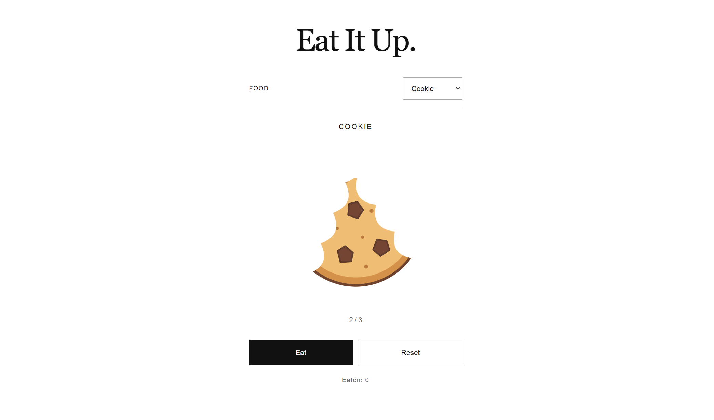

# Eat It Up

## Idea and Intended User

Eat It Up is a small interactive webpage where users choose a food and eat it in three clicks. It started as something to play with when bored, then developed into a playful way to count a wait.

It is intended for people with a little time to fill, such as while waiting for another webpage to load or waiting for food at a restaurant. Instead of expressing a wait in minutes, users can imagine saying, “I waited for five cookies.” These are possible uses of the project; the counter records foods eaten, not actual elapsed time.

The interface uses black, white and grey, while the food illustrations retain their colours. Short English labels and minimal controls keep the focus on the food and the action of eating.

## Main Interaction

Choose Cookie, Pizza or Pancake, then click Eat:

1. The first bite removes a large section from the upper right.
2. The second adds a bite on the upper left, slightly lower, creating an asymmetric outline.
3. The third removes the remaining food and displays “All gone.”

Each valid bite plays the same short, synthesised crunch sound. Reset restores the selected food. Switching foods starts a new three-bite sequence.

The Eaten counter increases by one whenever a whole food is finished. Reset and food changes preserve the total; refreshing the page returns it to zero.

## Screenshot

Cookie after two bites. The asymmetric bite marks are visible; Eaten remains at 0 because the food has not yet been finished.

## Screen Recording

[Watch the screen recording (MP4)](docs/demo.mp4)

## How to Run

Run index.html in a browser. Keep style.css, script.js and the assets folder alongside it. No installation, build tools or internet connection are required. Turn on your device's sound to hear the bite effect.

## Project Files

- index.html — page structure and shared SVG bite mask.
- style.css — layout and monochrome interface.
- script.js — food selection, bite states, audio and counter.
- assets/foods/ — cookie, pizza and pancake SVG illustrations.
- assets/audio/bite.wav — synthesised bite sound.
- PROCESS.md — development decisions, user feedback and AI assistance.

## Known Limitations

The count is a playful expression of waiting, not a timer: clicking speeds vary, and the project does not detect loading progress or restaurant waiting times. Progress is not saved after refreshing. The bite effect is stylised, and the sound is synthetic. Sound playback also depends on browser and device settings.

JavaScript syntax checks, simulated interaction tests and audio-file checks passed. These checks are separate from the two informal user trials described in PROCESS.md and do not establish full cross-browser, keyboard or responsive-layout compatibility.

## Credits

OpenAI Codex assisted with the HTML, CSS and JavaScript, SVG food illustrations, procedural audio synthesis, code-level checks and documentation. I supplied the idea and requirements, reviewed the outputs, directed revisions and gathered user feedback.

No third-party code libraries, downloaded food images, sampled audio or external datasets were used. No additional borrowed course code has been identified in the development record.

